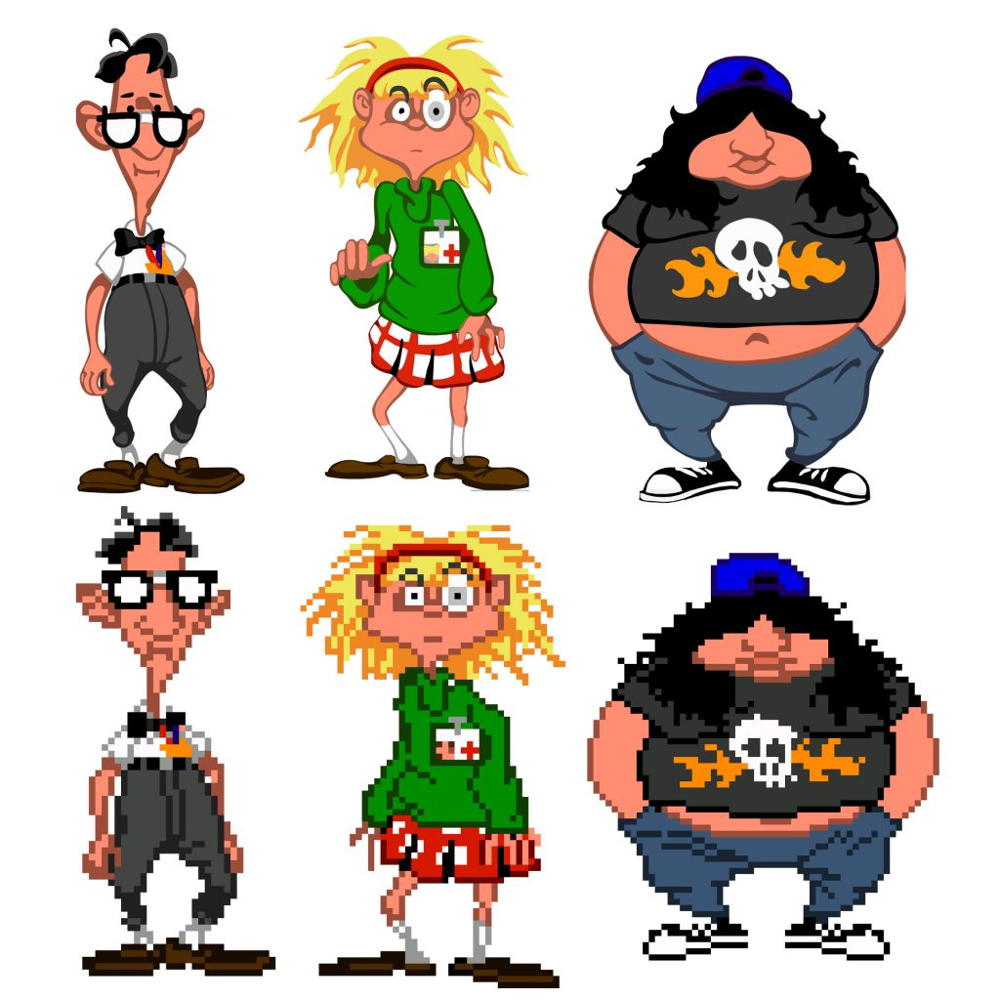

# Analyse før HD-nytegning: The Dig

Oppdatert 13. oktober 2026 etter Toms DOTT-eksempel, rettelsen om Bigfoot-strek og Purcell-referansene. Arbeidsdokument i `gpt-arbeid`; ingen motor, pipeline eller beskyttet jobbfil er endret.

## Føringer for dette spillet

The Dig beholder sine godkjente tegnede figurer og malte science fiction-miljøer. DOTT gir overførbare regler om identitet, form, plass, lokal farge og ingenting oppdiktet. Det gir ikke tillatelse til å gjøre The Dig om til Sam & Max eller flate ut malte bakgrunner. Purcell-avsnittet nedenfor gjelder bare Sam & Max.

Se [remake-guiden i main](https://github.com/Tombonator3000/Dig-HD-Remake/blob/main/docs/skills/scumm-hd-remake/SKILL.md), [hovedarkanalysen](rapporter/hovedark-20261012/ANALYSE.md), [overleveringen](rapporter/overlevering-ny-chat-20261010/START-HER.md) og [HD-sjekklisten](HD-SJEKKLISTE.md). Boston, Maggie og Brink skal beholde hver sin identitet gjennom planetklær og EVA-drakter. Robotarm og PIG er bestemte mekanismer, ikke frie variasjoner av et motiv.

## Hva vi skal oppnå

HD-tegningen skal tydeliggjøre det originalen forestiller og beholde riktig person, drakt, gjenstand og hendelse. Originalens positur, silhuett, proporsjoner, plass, palett, uttrykk og animasjon er innholdsfasiten. Stilreferanser bestemmer hvordan det tegnes tydeligere, ikke hva som legges til.

Før tegning må navn/rolle, ressurs-ID, rom, aktiv palett, tilstand og eventuelle sammensatte deler være koblet sammen. Et kostyme er ikke automatisk én person; en rute kan vise flere personer. Et inventarikon, en rekvisitt, en skygge og en effekt er ikke nye skapninger. Interne fil-/OBNA-navn er ikke automatisk navnene spilleren ser.

## DOTT-eksempelet og guiden

Tom viste Bernard, Laverne og Hoagie i original og HD 13. oktober 2026. Vedlegget viser et visuelt mål for kildetro nytegning. Det dokumenterer ikke Double Fines arbeidsprosess eller et målt, perfekt pikseloverlegg.

- Behold den enkelte figurens silhuett, kroppstype, klær og uttrykk. Ikke tegn flere figurer fra samme generiske ansiktsmal.
- Tolk pikselklynger som riktige former og materialer. Briller skal bli briller; et navneskilt skal ikke bli et tilfeldig symbol.
- Behold lokal farge per flate og originalens skygger. Et nytt høylys gir ikke tillatelse til å skifte palett.
- I tegneseriemateriale: bruk rene, sammenhengende konturer med levende variasjon, tydelige fargeflater og kontrollerte skygger. Unngå automatisk jevnbred svart kant rundt hver detalj.
- Behold originale kontaktpunkter, fotlinje, mål og feste mellom hode/kropp eller hånd/redskap. Kontroller dette med originalen i 1x, jobbens 4x-referanse og faktisk spillvisning.
- Samme ruteantall betyr ikke samme animasjon. Avspillingsrekkefølge, gjentakelser, varighet, speiling og overganger må også kontrolleres.

Se [det daterte DOTT-avsnittet fra guiden](referanser/dott-metode-fra-guide-20261013.md). Den oppdaterte teksten er kontrollert i Sam & Max main `3821e94` og Zak main `31f760e`. The Dig main `eb7c0b07` har den eldre guiden uten dette avsnittet ved kontrollen. Avsnittet er bevart her som referanse uten å endre kodegrenen.

## Brukerens strekrettelse: Bigfoot

Tom 13. oktober 2026: «synes du brukte litt for tykke streker på bigfoot du lagde tester på men ellers veldig bra.»

Dette er positiv tilbakemelding på konseptretningen med en konkret rettelse, ikke godkjenning av ferdige spritesheets. Bigfoot-prøvene fra 12. oktober skal få tynnere streker før de brukes som stilanker eller produksjonsfasit.

- Tynnere ytre kontur enn i de første Bigfoot-prøvene; innvendige ansikts-, hånd- og pelsstreker skal være lettere enn ytterkonturen.
- Varier trykk og tykkelse naturlig. Ikke gjør hele figuren til et svart klistremerke eller la konturene tette munn, øyne og fingre ved spillstørrelse.
- Behold Bigfoot-identiteten, pelskroppens store former, hodeform, munn og føtter. Endre strekføringen uten å legge til anatomiske detaljer.
- Ingen fast ny pikseltykkelse er målt eller godkjent. Kontroller en konkret prøve ved målestørrelsen, sammen med original og valgt stilreferanse.

Rettelsen gjelder de aktuelle Sam & Max-prøvene. Den er ikke en generell ordre om å tegne alle tre spillene med samme kontur eller omtegne godkjent grafikk.

## Sam & Max: Steve Purcell som stilgrunnlag

Tom har valgt Steve Purcells Sam & Max-uttrykk som stilgrunnlag og sendt to lesbare referansebilder samt et tredje skadet vedlegg. De lesbare bildene viser følgende, som visuell analyse av vedleggene:

- Streken varierer i tykkelse og har tilspissede avslutninger. Tynne konstruksjons-/ansiktsstreker står sammen med kraftigere silhuetter og bevisst plasserte svarte flater.
- Sams snute og nese er lange og tydelige; hatt, ører, jakkeslag, mage og store bare føtter har kantete og komisk overdrevne former. Han skal ikke bli en generisk rund hund i pen dress.
- Max har lange, bevegelige ører, liten kropp, store føtter og et bredt uttrykksfullt glis. Tennenes bølgede/sikksakkform varierer med tegning og uttrykk. Ikke innfør et universelt rektangulært tannrutenett fra én lavoppløselig rute.
- Fargereferansen har store sammenhengende fargefelt og få tydelige skyggeflater. Sort/hvitt-referansen bruker svarte flater og sparsom skravering til energi og dybde. Ikke legg slik skravering ukritisk på alle fargelag i spillet.
- Asymmetri, kantete former og særpreg er tilsiktet. Nytegningen skal ikke glatte dette bort til symmetrisk, plastaktig eller generisk figurdesign.

Purcell-bildene gir stil og identitetsforståelse. De gir ikke tillatelse til å flytte spillets hender/føtter, bytte drakt, tegne inn våpen, en rotte, bevegelsesstreker eller andre elementer fra illustrasjonene i ruter der de ikke finnes. Hit the Road-rutene og riktig spillpalett styrer fortsatt motiv og geometri. Bildene velges i en sammenhengende variant, ikke blandes tilfeldig mellom tegneserie, TV-serie og senere spill.

**Presisering av analysen fra 12. oktober:** Første Sam-kandidat fikk et emblemaktig hvitt hattemerke, og Max-kandidaten ble deretter styrt mot firkantede tenner. De nye referansene viser at hvite hattemarkeringer/høylys og en stilisert sikksakkmunn kan være del av riktig uttrykk. Bevar det den aktuelle originalen og valgte referansen faktisk viser. Verken helt ensfarget hattebånd eller firkantede tenner er en generell designregel. Ikke gjenbruk de avviste kandidatene som ankre.

Kilderegisteret [Steve's Sam & Max arts](https://samandmax.fandom.com/wiki/Steve%27s_Sam_%26_Max_arts) har en egen model-sheet-del med «How to draw Sam» og «How to draw Max». Det brukes som inngang til flere referanser og deres opphav, ikke som en ferdig teknisk spritesheet-oppskrift. Direkte sidehenting var blokkert av robots.txt; tekst fra søkeindeksen var tilgjengelig. Hele bildegalleriet er derfor ikke visuelt gjennomgått. Kontroller et konkret bilde og opphav før det brukes som nytt anker. [Purcells SpudVision-innlegg](https://spudvisionblog.blogspot.com/2010/07/sam-max-blog-coming-soon.html) peker på hans særskilte Sam & Max-blogg; dette er en primærkilde for videre kildearbeid.

## Minste kontrollgrunnlag før et produksjonsark

| Felt | Det som skal være avklart |
| --- | --- |
| Identitet | Personens navn eller eksplisitt uavklart rolle, kostymevariant og tilstand |
| Kilde | Spillutgave, kildefil, ressurs-/rute-ID og SHA-256 |
| Palett | Aktivt bruksrom og eventuelle skuespiller-/lys-/skyggeendringer |
| Deler | Hode/kropp, hånd/rekvisitt, sammensatte figurer og tomme ruter |
| Geometri | Originalmål, anker, fotlinje, kontaktpunkter og riktige retninger |
| Stil | Spillets eget godkjente anker og eventuelle konkrete brukerrettelser |
| Animasjon | Full rekkefølge, gjentakelser, tempo og overganger |
| Leveranse | Rå kandidat, ferdig fil, rutekart, SHA-256 og faktisk importert pakke |
| Kontroll | Teknisk kontroll, visuell kontroll, motoravspilling og Toms godkjenning ført hver for seg |

Behold beskyttede jobbfiler. Hvis en prompt har feil motiv eller motsier brukerens rettelse, skriv korrigert prompt og begrunnelse i et separat notat; ikke overskriv `prompt.txt`, `jobb.json` eller originalreferansen. Ingen resultater er automatisk visuelt godkjent fordi filformat, alfa, ruteantall eller en kantmåling består.

## Historisk Sam & Max-analyse, bevart i alle tre repoene

Den fullstendige [figur- og objektanalysen fra 12. oktober](rapporter/sam-max-konseptanalyse-20261012/ANALYSE.md) er bevart som et datert eksempel. Tellinger, kostymer, egennavn og tekniske funn der gjelder Sam & Max og det daværende uttrekket, ikke Zak eller The Dig. Rapporten må leses sammen med rettelsene og nyere repoanalyse; den er ikke et godkjent produksjonsgrunnlag alene.

Lærdommen som overføres er å fastslå riktig motiv før nytegning, skille personer fra objekter og effekter, bevare identitet gjennom alle varianter, bruke riktig palett og kontrollere hele animasjonen. Spesifikke SCUMM-formater, kostymenumre og avspillingsdetaljer må verifiseres i hvert spill.
