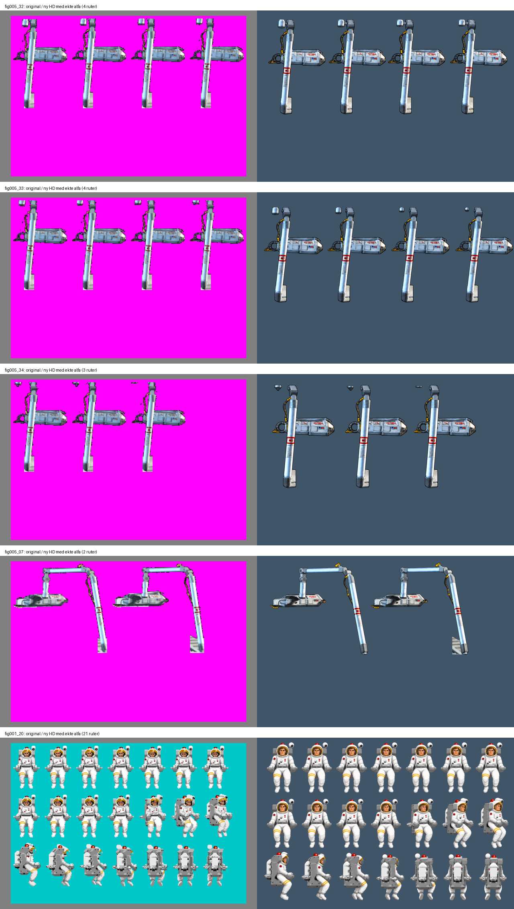

# Restgrafikk til mottak, 15. oktober 2026

Registrert 2026-10-15T09:58:55+02:00. Codex, innebygd ChatGPT-bildegenerator. Modellversjon er ikke eksponert.

Fem nye figurark for 34 ruter som mangler HD i publisert mod 05179ed. Boston: 21 ruter (costume001_062 til 082). Robotarm: 13 ruter (costume005_011,012 og 086 til 096).

Dette er levert grafikk til teknisk mottak. Ingen ny runtime-import, motorbygging, hd-mod eller spillpakke er publisert.

| Jobb | Ruter | Valgt forsøk | Minste diagnostiske omrissoverlapp |
| --- | --- | --- | --- |
| fig005_32 | 4 | 2 | 0.860 |
| fig005_33 | 4 | 1 | 0.840 |
| fig005_34 | 3 | 1 | 0.714 |
| fig005_07 | 2 | 3 | 0.627 |
| fig001_20 | 21 | 1 | 0.854 |

## Grunnlag og motiv

Engelsk standardutgave. Kildereferanser, originalruter, metadata og prompter er bevart og SHA-kontrollert i kildegrunnlag.json. De godkjente hovedarkene boston.png og robotarm.png brukes. Godkjenningen er registrert i rapporter/hovedark-20261012/GODKJENNING.md.

Boston-arket er sittende manøvreringsstol med jetpakke, ikke en stående astronaut eller Maggie. Tre rader med sju faser beholdes. Robotarmens utstrakte og lukkede posisjoner, mekaniske materialer og separat tilbaketrekkende metalldel er avklart mot originalene. Hovedarkene erstatter ikke kildenes positurer.

Den første robotarm 07-kandidaten hadde for store geometriske avvik (minst 0,457 diagnostisk overlapp). Et nytt forsøk var fortsatt for ulikt. Tredje forsøk brukes, med min 0,627. Ark 32 fikk en ekstra bildegenerert retting av den øvre delens ulike faser. Uvalgte native forsøk beholdes lokalt og er registrert med SHA i forsok.json.

## Kontroll som er utført

- Alle fem PNG-er er 1536 x 1024 RGBA, alfa 0 til 254. Native byte og alfa er bevart; ingen ny pikselmaske, retusjering eller fargejustering er brukt på leveransen.
- Rutetelling: 4, 4, 3, 2 og 21. Alle 34 original-ID-er har eksplisitt rutekart med native alfa-128-boks. Løse mekaniske deler innen ruteboksen beholdes samlet.
- Original og HD er sett side om side. Faktisk alfa er sett over hvitt, grønt og svart. QA-komposisjoner er inspeksjonsbilder; de erstatter ikke native-filen.
- Målingene normaliserer omrissboksene før sammenligning. De er bare diagnostikk og bruker ikke motorens plassering, skalering eller palett. De er ikke et bevis for bestått dighd-mottak.
- Beskyttede referanse.png, original_1x.png, prompt.txt og jobb.json er kontrollert mot kildegrunnlaget uten endring.

## Åpent ved mottak

- Kjør eksisterende dighd myke-figurer med dette fremdriftsmanifestet og rutekartet. Bruk den nye versjonerte Boston-filen; den eldre holdte resultat.png er bevart.
- Robotarm 07 har tynne segmenter og størst geometrisk usikkerhet. Kontroller håndtering av endefragmentene, feste, vinkler og overgangene til eksisterende ruter 010/013. Ark 32 til 34 må kontrolleres som én fasefølge, også over arkgrensene.
- Boston har 339 native piksler med alfa over 16 utenfor fem piksler fra alfa-128-kjernen (maks 120). Se qa-malinger.json for ti-pikslerskontrollen. Ingen alfa er manuelt slettet. Kontroller små løse detaljer og rester ved eksport.
- Sammenlign hele animasjonen med originalens rekkefølge, timing, retninger, kontaktpunkter og faktisk palett i motoren. Disse kontrollene og Toms godkjenning av de nye animasjonsrutene gjenstår.
- Bevar r12 ved senere modbygging med eksisterende flett-mod. Ingen publiserte bilder skal overskrives som bieffekt av mottaket.

## Videre arbeid

Kostyme 008, tunnelvariantene 022/023 og øvrige hovedpersonhull gjenstår. fig071_08 er undersøkt, men ikke produsert i denne runden: originalen viser oppløsnings-/partikkelfaser, ikke åtte hele Boston-figurer. Produksjonen trenger riktig fasekontekst; ingen nye personer eller effekter er funnet på. Filmene er fortsatt utsatt.

Kildepromptene er beholdt. Faktiske prompter og tillegg ligger i prompter/. Figuridentitet og mekanisk motiv er presisert separat der den gamle generiske kostymebeskrivelsen ikke var tilstrekkelig.
