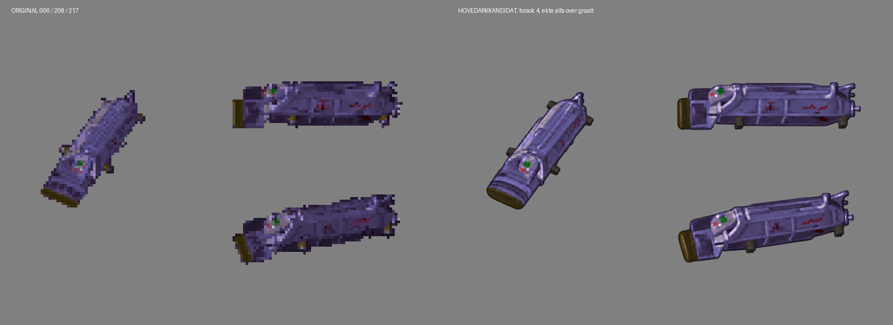

# Pig: nytt hovedark til vurdering

Tom ba 11. oktober om ny Pig-grafikk og presiserte at Pig er en automatisert null-G-utstyrscontainer med verktøy og ladninger. Den er ikke selve sprengladningen. Funksjonsbeskrivelsen gir ikke grunnlag for nye logoer, ekstra redskaper eller oppdiktet innhold; originalgrafikken bestemmer utseendet.

Forsøk 4 er lagret i [hovedark/pig.png](../../../hovedark/pig.png). Det er en vurderingskandidat, ikke Toms godkjente hovedark eller en ferdig animasjonsserie. De tidligere leverte fig007_01/05/08/09 er bevart. De skal fortsatt ikke brukes som motivanker.

Originalene er ekte RGBA-ruter 006, 208 og 217 fra kostyme 7, kontrollert mot de ni referansearkene. Det er tre virkelige animasjonsvinkler, ikke en oppdiktet ortografisk turntable. [Kildeplaten](original-tre-visninger.png) er bare en diagnostisk forstørrelse. Kildenes SHA256 og plasseringen i platen står i `kildegrunnlag.json`; uttrekksproveniensen ligger i `../nyordre-mottakskontroll/originaluttrekk.json`.

## Resultat og forbehold

Den smale blålilla kroppen, de langsgående ribbene, de to burgunderfargede sidefeltene, kontrollfeltet og asymmetriske endene følger originalen bedre enn tidligere ark. Runde blanke sidebolter fra forsøk 3 er i forsøk 4 endret til små mørke kantete fester, og olivenenden er dempet.

Kontrollfeltet har fortsatt små hvite/oransje prikker som er tydeligere enn kilden. Olivenenden er mer oval og høylysene blankere enn de små, mørke originalflatene. De røde sidefeltene er mer flekkete. Disse punktene skal vurderes av Tom før serien bruker hovedarket.

Root og to uavhengige Codex-agenter har sett kandidaten på grå alfakompositt mot originalene. Begge agentene anbefaler den som vurderingskandidat med forbehold, ikke som godkjent serieanker. Agenten kalt claude_samarbeid er en Codex-agent; dette er ingen bekreftelse på at Claude har mottatt eller testet bildet.

## Forsøk og kontroll

- Fem native forsøk med den innebygde ChatGPT-bildegeneratoren. Eksakt modellversjon ble ikke eksponert. `prompter/` og `forsok.json` dokumenterer prompter, referanser, SHA256 og utvalg.
- Forsøk 1 og 2 overtolket mekanikken. Forsøk 3 ga bedre hovedform, men for blanke, runde fester. Forsøk 4 er valgt. Forsøk 5 dempet kontrollprikker, men endret proporsjoner og lys uønsket og erstatter ikke 4.
- Valgt PNG er native RGBA 1536 x 1024, kopiert byteidentisk med generert alfa. Ingen hardmaske, alfarydding eller kreativ etterbehandling. Gråbilder og sammenligningsplater er diagnostikk.
- Mørk glød i rå RGB-visning er skjult fargeinformasjon, ikke synlig bakgrunn i grå alfakompositt. Dette må ikke brukes som en feilrapport om spillgrafikken.
- Alle 44 beskyttede kildefiler og eksisterende Pig-resultater/notater har uendret SHA256. De 38 uvedkommende lokale arbeidsfilene er bevart. Ingen kode, status.csv, RAPPORT.md eller retur.md er endret.

## Klar neste handling

[ORDRE.md](../../../ORDRE.md), oppdatert i a464f389, krever: «Tom godkjenner hovedarkene.» Etter vurderingen skal godkjent Pig-hovedark følge som bilde to i nye figurark.

`seriekildeko.json` forbereder alle ni kildeark og 241 ruteoppføringer. 37 har færre enn 40 synlige originalpiksler; ingen er ren magenta. Ekte løse ringer, kapper, fragmenter, utliggere og lysglimt må bevares i sine kildefaser, ikke tegnes inn som permanent utstyr. Køen er forberedelse, ingen ny leveransetelling. Pig har fortsatt 4 av 9 gjeldende resultatfiler; dette betyr ikke visuell godkjenning.

Neste handling: Tom vurderer kandidaten mot originalplaten. Ved godkjenning tegnes de ni Pig-arkene med samme konstruksjon og med kildefasen som fasit. Claude kontrollerer import, mod og animasjon etter leveringen. Dette hovedarket er ikke importert eller spilltestet av root.
