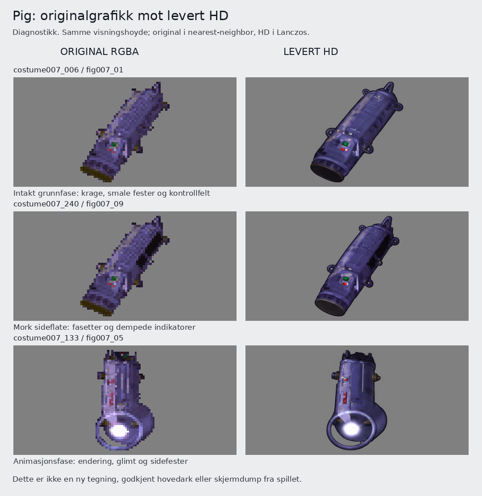
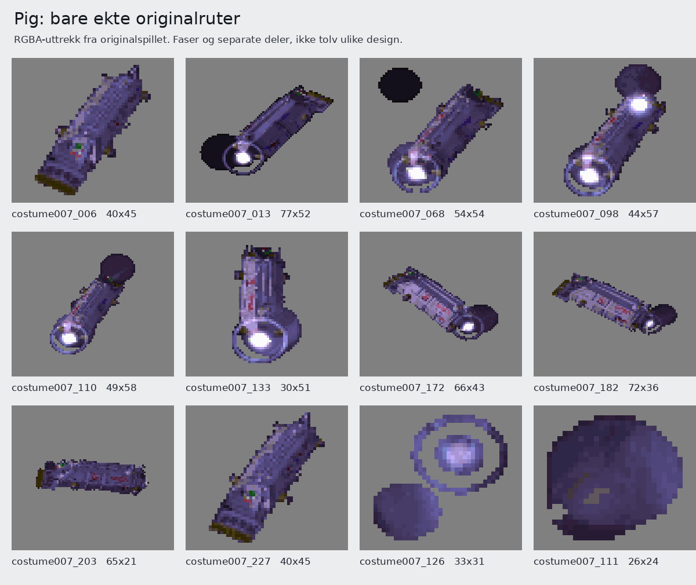

# Pig: originalstudie etter Toms tilbakemelding

11. oktober 2026. Tom: «Studer the pig mer.. Den ligner ikke på original art asset».

Pig-arkene er en for fri tolkning av originalgrafikken. Tidligere kontroll la for stor vekt på ruteantall, alfa og import. Den fanget ikke den endrede mekaniske konstruksjonen godt nok. De fire leverte revisjonene `fig007_01`, `fig007_05`, `fig007_08` og `fig007_09` skal ikke brukes som design- eller stilanker for videre Pig-arbeid. Dette overstyrer tidligere formuleringer som «approved_anchor» i agentmetadata; de var ikke Toms godkjenning av Pig.

## Hva som er undersøkt

Alle ni originale kostyme 007-ark, deres 241 ruteoppføringer og ekte originale RGBA-uttrekk er gjennomgått i delt kontroll. De fire nevnte HD-arkene er sammenlignet med originalene. Uttrekket ligger lokalt i `/home/tombonator3000t/.codex/tasks/the-dig-romlag-brink-20261010/extract-nyordre/costumes/`. Proveniensen finnes i `../nyordre-mottakskontroll/originaluttrekk.json`. Tidligere Pig-notaters opplysning om manglende individuelle originalbilder er utdatert.

Originalen står til venstre, dagens native HD til høyre. Begge bruker ekte alfa på nøytral grå bakgrunn. Samme visningshøyde gjør detaljene sammenlignbare; dette er ikke en måling av faktisk størrelse i spillet. Originalen er forstørret med nearest-neighbor, HD med Lanczos. Utsnittene kommer fra eksisterende rutekart. SHA256, stier og bokser står i `grunnlag.json`.

## Konkrete designavvik

| Del | Original | Levert HD og nødvendig retting |
| --- | --- | --- |
| Kropp og skyggeflater | Smal, avlang beholder med fasetter, langsgående ribber og tydelige mørke sideflater. Se `006`, `228`, `233` og `240`. | For jevne, avrundede kapsel-/sylinderflater og et nytt regelmessig panelmønster. Følg originalens flater, ribber og kontur i hver fase. |
| Endekrage | Bred, mørk og mindre regelmessig i silhuetten. Ingen dokumentert ny åpen munning. | Den rene ovale avslutningen og tydelige metallranden gir en annen konstruksjon. Kopier kildens form og flateinndeling. |
| Fester | Små, smale utstikk med begrenset informasjon i originaloppløsningen. | Store avrundede løkker og håndtak er en for sterk tolkning. Bevar de konkrete utstikkene uten å bestemme en ny mekanisk funksjon for dem. |
| Kontrollfelt | Lite felt nær endekragen. I `006` og `233` er grønt en klynge på 2 x 2 originalpiksler, lokalt x14 til15/y27 til28, med rødt like nedenfor. | Store grønne/røde knapper i et lyst, rent panel endrer lesningen. Bruk små, dempede markeringer med kildebestemt plassering og størrelse. |
| Sidepaneler | `203` og `208` viser to avlange innrammede felt med dempede burgunderrøde markeringer og langsgående skinner. | Ikke erstatt dette med mange oppdiktede paneler, metallknopper eller blanke rør. Disse originalfasene må inngå i konstruksjonsgrunnlaget. |
| Materiale og farge | Blålilla metall, fiolettgrå kanter og mørke/olivenfargede småfester. | HD har andre kontrastflater og mer polert materialtolkning. Rett konkrete flater og indikatorfarger. Hele HD-tegningen er ikke generelt lysere enn kilden; globale medianverdier viser tvert imot mørkere HD i de tre sammenlignede utsnittene. |

Originalen har en sylindrisk hovedform. Problemet er tolkningen av formens flater, krage, fester og detaljer, ikke at enhver rund flate er feil. Globalt sideforhold er heller ikke nok til å bevise at hele objektet er blitt for langt eller bredt.

## Ikke bland animasjonsdeler med intakt konstruksjon

- `006`, `228` og `233` er gode kilder for intakt helhet. `203` og `208` viser sidepanelene tydeligere.
- `133`, `182` og flere andre ruter har sterke hvite glimt i bestemte faser. De skal ikke bli en permanent hvit lykt i den intakte modellen.
- Ringer, senterskiver, kapper og små fragmenter i animasjon 6 er egne kilderuter eller separate deler av samme rute. De er ikke bevis for faste hjul eller ekstra sidetanker.
- `012` har ytterring og senterskive adskilt av ekte gjennomsiktighet. Bevar åpningen og delene. Ikke fyll mellomrommet eller fullfør sparsomme deler.
- Ikke lås et oppdiktet universelt antall håndtak. Synlige utstikk endres ved rotasjon; hver kildes kontur er fasiten.

## Størrelse og kontrollgrenser

`064` er 174 x 134 originalpiksler. Hoveddelen ligger bare i boksen `[10,6,61,54]`, altså 51 x 48. En separat mørk skive og to isolerte piksler utvider totalboksen. Ikke strekk Pig til hele boksen eller mal den separate skiven fast på intaktmodellen. Dette er en egen import-/ankerfelle.

Intaktserien `233` til `240` har 40 x 45-bokser, bortsett fra `236` med 41 x 45. Det gir ikke grunnlag for merkbar størrelsespuls. Stabil fysisk størrelse og fasekobling må kontrolleres i animasjonen etter en korrigert leveranse.

Lokal v2-kontroll av de fire leverte arkene ga 66 ok og én sjekk, hvor `126` var sjekk. Disse tallene beviser importgeometri innenfor kontrollens grenser, ikke riktig design. Skjult RGB ved alfa 0 skal ikke omtales som en synlig glorie. Det er ikke utført ny import, motorkjøring eller spilltest i denne studien.

## Videre rettingsgrunnlag

Lag det bestilte `hovedark/pig.png` direkte fra de ekte originalkildene, med tydelig sporbarhet for hver visning. Bevar den glatte tegnede stilen, men kopier originalens konstruksjon og materialflater. Ikke bruk de fire avviste HD-tolkningene som motivanker. Uklare lavoppløste detaljer skal gjengis forsiktig, ikke fylles ut med ny mekanikk. Ikke kall ulike animasjonsfaser ortografiske front-/side-/bakvisninger uten kildebelegg.

Tom vurderer det korrigerte hovedarket før flere Pig-ark tegnes, slik gjeldende `ORDRE.md` ber om. Deretter må de leverte 01/05/08/09 også revideres mot det godkjente hovedarket. De fem tidligere tilbakeholdte arkene forblir tilbakeholdt. Teknisk leveransetelling 4/9 betyr fortsatt ikke visuell godkjenning.

Denne leveransen består av studierapport, sammenligningsbilder og kildeproveniens. Ingen ny grafikk er generert. Originalfiler, eksisterende resultatbilder, notater, rutekart og leveranseregistre er bevart uendret.
