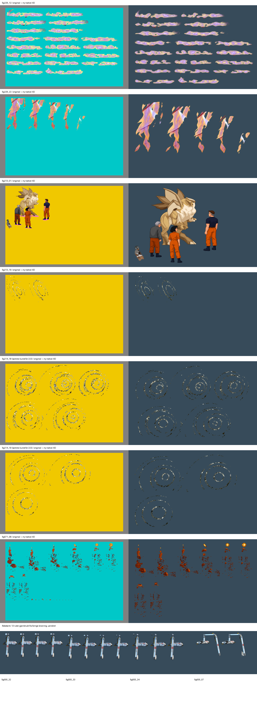

# Grafikkleveranse for 66 øvrige ruter

Codex, registrert 2026-10-15T16:24:54+02:00. Innebygd ChatGPT-bildegenerator; modellversjon ikke eksponert.

**Alle 66 bestilte mål-ID-er har en grafikkleveranse:** 53 i denne runden og 13 uendrede robotarmruter fra forrige runde. Dette er leveransedekning, ikke bekreftet HD-dekning i den publiserte modden.

| Gruppe | Mål-ID-er | Leveranse |
| --- | --- | --- |
| Lockup, kostyme 229 | 25 | To nye ark: energifaser og rester |
| Theeye, 213/214/222 | 20 | Scene, fragmenter og spiralfaser |
| Nexus, kostyme 071 | 8 | Fragmenterte tau-/gnistfaser |
| Robotarm, kostyme 005 | 13 | Fire tidligere leverte ark, SHA-kontrollert og gjenbrukt |

## Filer og sporbarhet

Alle 66 mål-ID-er, resultatfiler, SHA-256 og native bokser står i [dekning-66.json](dekning-66.json). De ni nye kostymearkene står i [fremdrift.json](fremdrift.json), med eksplisitt [rutekart](rutekart.json). Faktiske prompter er bevart i [prompter](prompter/). Beskyttede kilders SHA og utvalget står i [plan.json](plan.json).

Kostyme 214 og 222 har byteidentiske originale referanser og rektangler for de berørte fasene. To nye native ark er derfor brukt uendret for begge kostyme-ID-ene. Det gir ni kostymeark fra sju unike nye bilder. Samme kunst betyr ikke at originale indekskoder kan byttes mellom kostymene.

Alle valgte native PNG-er er 1536 x 1024 RGBA med alfa 0 til minst 251. De er kopiert byteidentisk fra generatoren. Ingen fargelås, manuell pikselmaske, skalering eller kreativ etterbehandling er brukt på produksjonsfilene. QA-komposisjoner er inspeksjonsbilder, ikke produksjonsfiler. Eldre resultat.png-er og deres notater er bevart.

## Motiv og rettelser

De generiske personnavnene skjuler at mange mål-ID-er er effekter. Kildene styrer hvilket motiv hver fase faktisk viser. Energi er ikke gjort om til mennesker, spiralfragmenter er ikke gjort til fylte portaler, og de isolerte fragmentene er ikke fullført som nye figurer. Boston, Maggie og Brink i den sammensatte scenen følger godkjente hovedark med originalens poser og spillfarger. Skapningens kildeformer er beholdt uten nye blå detaljer.

Første lockup-ark var for neonpreget. Et bildegenerert nytt forsøk dempet fargene mot originalens lavendel/kremskala. Den sammensatte scenen fikk en målrettet retting som fjernet en ny blå brystdetalj og blått øye. Uvalgte native forsøk er bevart lokalt og registrert med SHA i forsok.json.

## Kontroll utført

- Alle 53 nye mål-ID-er og 13 gjenbrukte arm-ID-er er unike og stemmer med den bestilte fordelingen 25 + 20 + 8 + 13.
- Bildeformat, størrelse, ekte alfa, output-SHA, kilde-SHA og antall fasevinduer er kontrollert. Alle alfa-16-piksler i de nye arkene er innen de dokumenterte fasevinduene.
- Original og ny kunst er sett side om side. Native alfa er undersøkt over hvitt, grønt og svart. Lossless sammenligninger per rute ligger i [qa](qa/).
- Rutekartene er rettet for å holde små deler fra en nabofase ute av boksene, særlig i nexus og de spredte spiralene. Native-piksler er ikke slettet for å oppnå dette.

## Åpent ved teknisk mottak

Omrissdiagnostikken i qa-malinger.json normaliserer boksene og måler alfa-kjerner. Den er ikke motorens registrering eller et teknisk pass. De spredte spiralene har særlig lav direkte kjerneoverlapp; behold dem som kandidater til kontroll og kontroller hver fase mot originalens partikkelplassering før publisering. Dette er ikke en påstand om at alle 66 er visuelt godkjent.

Mottaket må bevare svake effektfragmenter og alle gjennomskinnelige deler. Boksene bruker alfa 16; eksisterende mottak finner kjerner ved alfa 128. Kontroller at dette ikke mister ekte svak grafikk. Originalens 14 ruter under 40 piksler utenfor akkurat denne gruppen beholdes som original/fallback, og er navngitt i dekning-66.json. De er ikke feilaktig merket tomme eller tekniske.

Kostyme 229 bruker kodek 5 med like RGB-farger for forskjellige indekskoder. Ekte indekser må leses fra originalspillet, ikke gjettes fra RGB. Ingen nye indeksbilder er produsert her.

Avspill hele berørte sekvenser i originalens rekkefølge og tempo med riktig rompalett, samtidige lag og overganger til eksisterende HD. Kontroller skapning/personer samlet, spiralene over rommet og robotarmen i bevegelse. Toms godkjenning av hovedarkene er ikke automatisk godkjenning av disse animasjonene.

Ingen motor, spillpakke eller publisert hd-mod er endret. Det er ikke kjørt motorimport eller spilltest i denne grafikkrunden. Ved senere modbygging må den publiserte r12-modden bevares gjennom eksisterende flett-mod.
